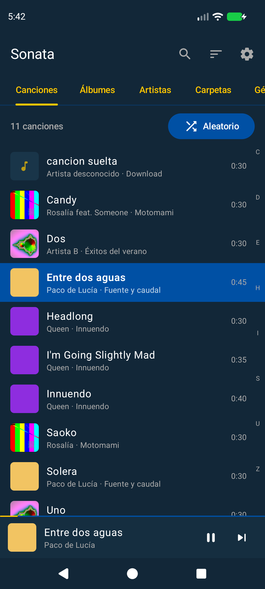
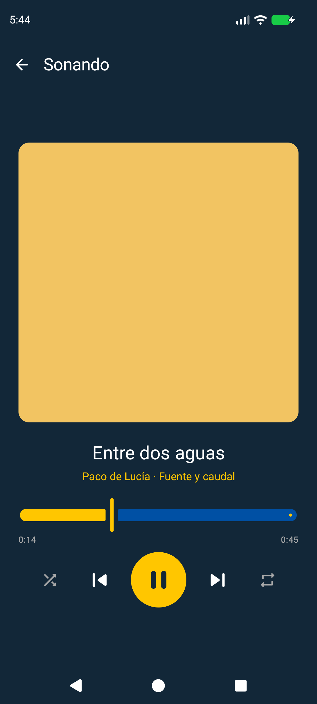
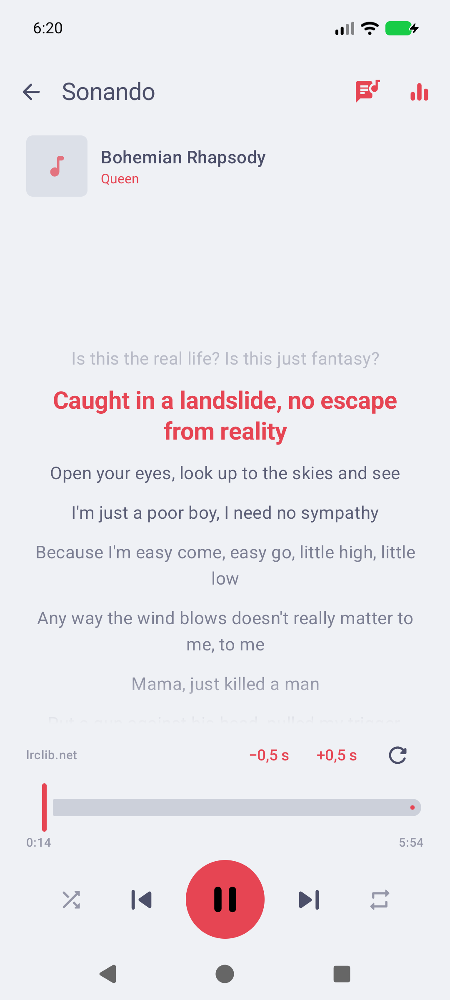
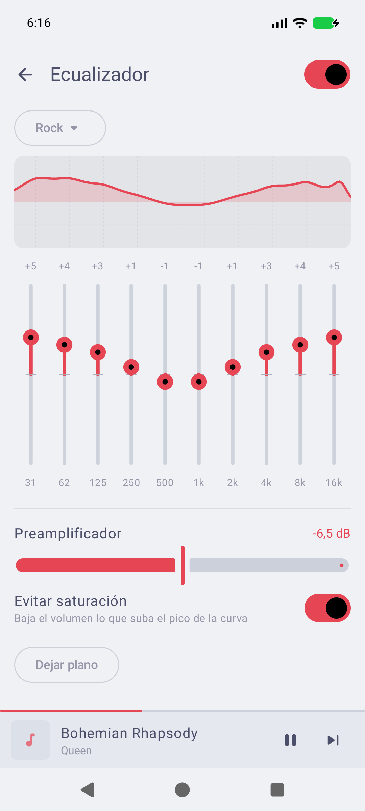
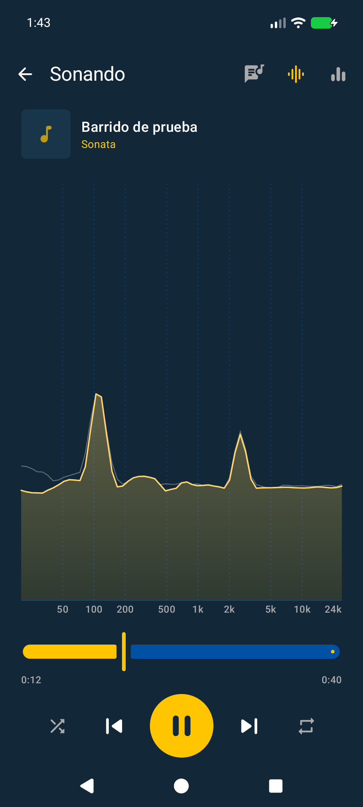
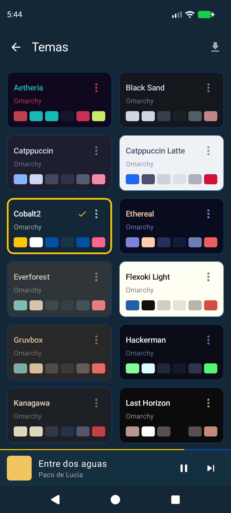
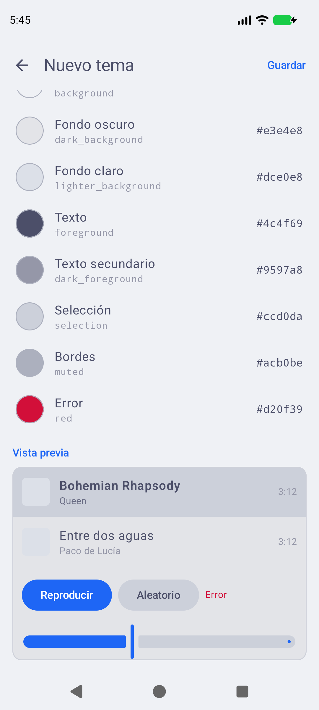

# Sonata para Android

Reproductor de música local para Android, hermano del
[Sonata de escritorio](https://github.com/julssvanderhaack/sonata). Usa los temas de
[Omarchy](https://omarchy.org) como paletas de colores, que se pueden editar,
importar y exportar en el mismo formato `colors.toml` del escritorio.

> Estado: **0.5**. Hay biblioteca por carpetas, filtros, temas, reproducción en segundo plano,
> cola editable, listas de reproducción, reanudar con la app cerrada, letras sincronizadas,
> ecualizador, espectro en vivo y «Abrir con Sonata». Faltan las listas (ver *Pendiente*).

**Descargar:** el APK está en [Releases](https://github.com/julssvanderhaack/sonata-android/releases/latest).
Ábrelo en el móvil y acepta instalar desde fuera de la tienda. Necesita Android 8.0 o superior.

| Canciones | Sonando | Letra sincronizada | Ecualizador | Espectro |
|---|---|---|---|---|
|  |  |  |  |  |

| Temas | Editor de temas |
|---|---|
|  |  |

*Las capturas son del emulador, con canciones inventadas generadas con ffmpeg.*

## Qué hace

- **Busca en las carpetas que tú eliges** (una o varias, en *Ajustes → Biblioteca* o al
  abrirla por primera vez), con sus subcarpetas. Las recorre y lee las etiquetas ella
  misma, sin depender de MediaStore: encuentra también lo que llega por SFTP, `adb` o
  apps que no avisan al índice de Android. No pide permisos de almacenamiento: cada
  carpeta elegida con el selector del sistema da acceso a sí misma.
  - Solo vuelve a leer las etiquetas de lo nuevo o modificado; la primera vez la
    biblioteca se va llenando mientras lee, con un contador.
  - Botón ⟳ en la biblioteca para volver a buscar; dice cuántas canciones son nuevas,
    han cambiado (renombradas, movidas, reetiquetadas) o ya no están. También busca sola
    al abrir la app, al volver a ella pasados dos minutos y cuando Android avisa de cambios.
  - De paso encuentra el `.lrc` con el mismo nombre que cada canción y la carátula de la
    carpeta (`cover.jpg`, `folder.jpg`…).
- **Cola y listas**:
  - mantener pulsada una canción: *Reproducir a continuación*, *Añadir a la cola*,
    *Añadir a una lista…*; el ⋮ de un álbum, artista, género o carpeta hace lo mismo con
    todas sus canciones;
  - pantalla *Cola* (desde *Sonando*): tocar para saltar, ✕ para quitar, arrastrar para
    reordenar, *Guardar como lista*;
  - pestaña *Listas*: crear, renombrar, borrar, reordenar y quitar canciones. Se guardan
    en una base de datos aparte de la biblioteca, así que ni volver a buscar ni actualizar
    la app las borra. Una canción que ya no está sigue en la lista con su nombre.
- **La cola sobrevive**: se guardan la cola, la canción, la posición, el aleatorio y la
  repetición; al volver a abrir Sonata está donde la dejaste, en pausa.
- **Reanudar con la app cerrada**: el *play* de los auriculares o del coche y la tarjeta
  multimedia del sistema la despiertan y siguen con la cola guardada. El servicio es un
  `MediaLibraryService`, así que el sistema (y Android Auto) pueden navegar por listas,
  álbumes, artistas y canciones.
- **Abrir con Sonata**: los exploradores de archivos ofrecen Sonata para los archivos de
  audio, aunque no estén en las carpetas de la biblioteca.
- **Descarta lo que no es música**:
  - lo que dure menos que la *duración mínima* (10 s por defecto) o pese menos que el
    *tamaño mínimo* (100 KB);
  - notas de voz y audios de WhatsApp y Telegram, carpetas `Android/…` de las apps,
    grabadoras, etc., mediante patrones editables (`*WhatsApp*`, `*PTT-*-WA*`…), que
    también cazan una nota de voz guardada en `Download/`;
  - las carpetas que desmarques en *Ajustes → Carpetas*.

  Los filtros se aplican al leer y no al escanear, así que cambiarlos no obliga a
  volver a buscar.
- **Explorar por** canciones, álbumes, artistas, carpetas y géneros. La pestaña de
  géneros solo aparece si al menos un 10 % de las canciones tiene género.
  - Orden por título, artista, álbum, año, duración o fecha de añadido, con orden
    alfabético español (Á junto a A, Ñ después de N) y barra de letras para saltar.
  - Los álbumes se agrupan por carpeta y se unen por *artista del álbum*, así que un
    álbum con etiquetas a medias no se parte en dos y CD1/CD2 quedan juntos.
    Sin etiquetas, el álbum es el nombre de la carpeta.
  - Los artistas usan el artista del álbum, para que «X feat. Y» no cree artistas sueltos.
  - Las carpetas encadenadas se compactan (`Music/Rock/Metallica` en una fila).
  - Búsqueda sin tildes ni mayúsculas por título, artista, álbum y nombre de archivo.
- **Reproducción** con Media3/ExoPlayer en un servicio: sigue sonando con la pantalla
  apagada, con notificación, controles en la pantalla de bloqueo, Bluetooth y
  auriculares, y se pausa al desenchufarlos.
- **Letras**, en este orden, como en el escritorio:
  1. un `.lrc` (o `.txt`) con el mismo nombre que la canción, si le das permiso a la
     carpeta de tu música en *Ajustes → Letras* (el permiso de audio no cubre esos
     archivos);
  2. la letra incrustada en el archivo: USLT de ID3, `LYRICS` de FLAC/Ogg/Opus o
     `©lyr` de M4A;
  3. la caché;
  4. [lrclib.net](https://lrclib.net), que viene **desactivado** hasta que lo actives
     (en Ajustes o con el botón que aparece cuando no hay letra). Solo envía título,
     artista, álbum y duración. Si la letra incrustada no está sincronizada, se muestra
     mientras busca en lrclib una versión con tiempos.

  Las sincronizadas resaltan la línea que suena y la mantienen a un tercio de la
  altura. Pulsar una línea salta a ella, y ±0,5 s corrige el desfase de esa canción.
  Si mueves la letra con el dedo, deja de seguir la canción durante 4 s.
- **Ecualizador** de 10 bandas, con los mismos filtros, preajustes y "evitar
  saturación" que el escritorio (portados de `eq.cpp`):
  - curva de respuesta real;
  - preajustes propios;
  - preamplificador;
  - doble toque en una banda para devolverla a 0.

  Funciona como un procesador dentro de ExoPlayer, así que no depende del ecualizador
  de cada fabricante. Apagado o plano, deja el audio intacto bit a bit (hay un test
  que lo comprueba).
- **Espectro en vivo**, como el del escritorio (port de `spectrum.cpp`): FFT de 4096
  puntos, bandas logarítmicas de 30 Hz a 18 kHz, picos que se sostienen y caen, unos
  30 fotogramas por segundo sea cual sea el refresco de la pantalla. Va sincronizado
  con lo que se oye, no con lo que se decodifica (Android decodifica ~0,5 s antes) y
  dibuja también el efecto del ecualizador. Solo trabaja mientras está en pantalla y
  sonando.
- **Temas**: los 27 de Omarchy que hay en `assets/themes`, más los tuyos.
  - *Duplicar y editar* abre un editor que se dibuja con el tema que estás editando,
    así que hace de vista previa.
  - El selector de color tiene tono, saturación y brillo, campo hex y los colores de
    la propia paleta como atajos.
  - Importar y exportar `colors.toml`, para llevar un tema del escritorio al móvil o
    al revés.
  - Opción de Material You (los colores del fondo de pantalla) en Android 12 o superior.

## Colores: de Omarchy a Material 3

| Omarchy (`colors.toml`) | Material 3 |
|---|---|
| `accent` | `primary` |
| `background` | `background`, `surface` |
| `dark_background` / `darker_background` | `surfaceContainerLow` / `Lowest` |
| `lighter_background` | `surfaceContainerHigh`, `surfaceVariant` |
| `foreground` | `onBackground`, `onSurface` |
| `dark_foreground` | `onSurfaceVariant` |
| `selection` (+ `selection_foreground`) | `secondaryContainer` (+ `on…`) |
| `muted` | `outline` |
| `red` | `error` |
| `cyan` / `magenta` | `tertiary` |
| `mode` | tema claro u oscuro |

Si falta alguna clave se calcula con las mismas reglas que el escritorio
(`theme.cpp`). Los temas antiguos que solo traen `color0…color15` y
`selection_background` también funcionan. El color del texto sobre el acento o la
selección se elige por contraste (WCAG), y un test comprueba que todos los temas
incluidos se leen bien.

## Compilar

Requisitos: Android SDK con la plataforma 37 (`~/Android/Sdk`, o `sdk.dir` en
`local.properties`) y un JDK 17 o superior (vale el de Android Studio).

```sh
export JAVA_HOME=/opt/android-studio/jbr
./gradlew assembleDebug           # app/build/outputs/apk/debug/app-debug.apk
./gradlew testDebugUnitTest       # paletas, filtros, agrupación, letras, ecualizador y espectro
adb install -r app/build/outputs/apk/debug/app-debug.apk
```

Para refrescar los temas desde el Omarchy instalado: `tools/import-omarchy-themes.sh`.

- Android 8.0 o superior (API 26).
- Kotlin, Jetpack Compose (Material 3), Room, DataStore y Media3.

## Organización

```
app/src/main/kotlin/io/github/julssvanderhaack/sonata/
  theme/     Palette (colors.toml → colores), ThemeRepository, SonataTheme (→ Material 3)
  lyrics/    parseLyrics (LRC), LyricsRepository (.lrc, etiquetas, caché, lrclib.net)
  eq/        filtros y preajustes (port de eq.cpp), EqProcessor dentro de ExoPlayer
  spectrum/  SpectrumSink (captura sincronizada con el altavoz), Analyzer (port de spectrum.cpp)
  library/   Track + Room, Scanner (carpetas elegidas por SAF), LibraryFilter, Grouping (álbumes, artistas…)
  player/    PlaybackService (MediaSessionService), PlayerConnection (MediaController)
  settings/  Settings (DataStore)
  ui/        pantallas Compose y navegación
```

## Pendiente

- FFmpeg para formatos que Android no decodifica (WMA, APE…).
- Declarar la app para Android Auto (`automotive_app_desc`) y probarla en un coche.
- Importar y exportar listas `.m3u`.
- Traducción al inglés (`values-en`) antes de publicar.
- Revisar la licencia de cada tema de terceros antes de publicar (los de serie de
  Omarchy, Aetheria y Vulkanite son MIT).

## Licencia

GPL-3.0, como el Sonata de escritorio.
